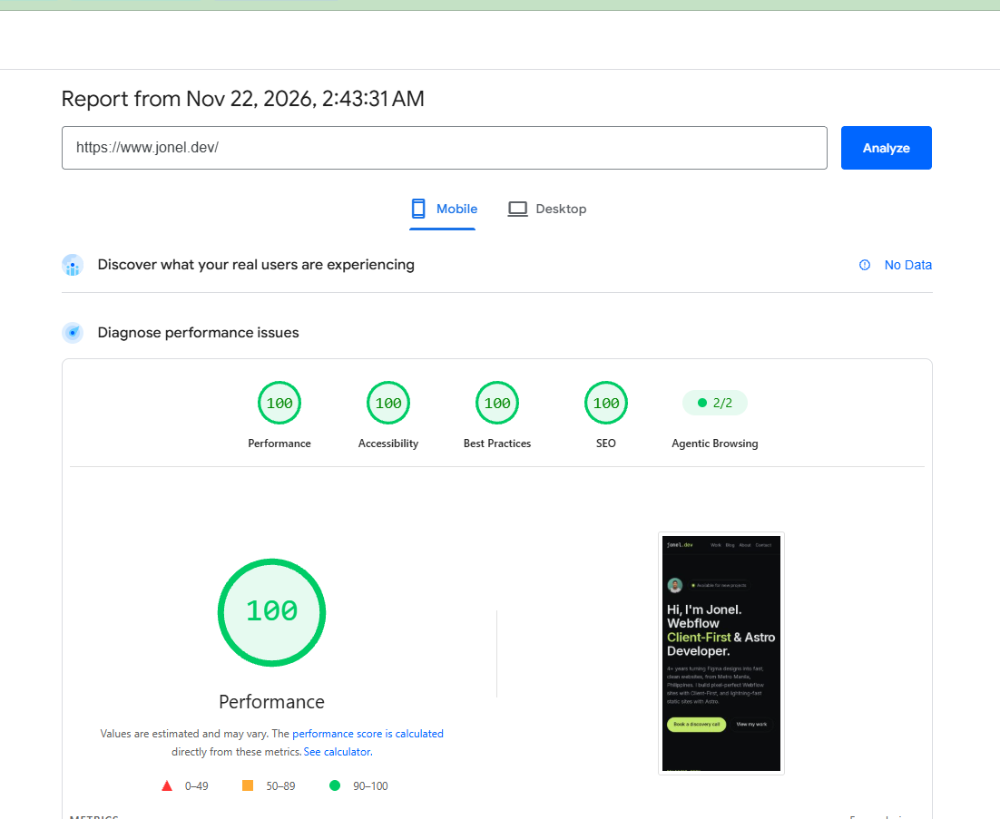
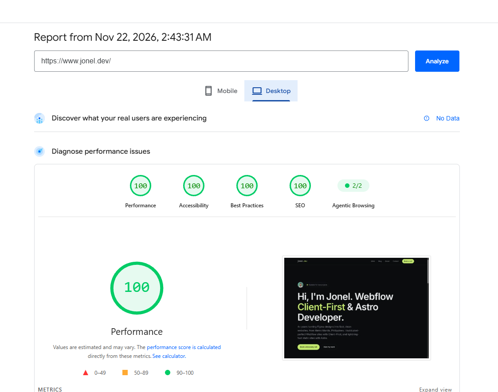

I build websites for a living, so my own site should prove I can do it well.
My old portfolio didn't. It pulled its content from a separate CMS backend, and
at some point the projects and testimonials sections started showing up empty,
with stats like "0 Projects Completed".

So I rebuilt it from scratch with **Astro**. The result: a perfect
**100 / 100 / 100 / 100** on Google PageSpeed Insights, on both mobile and
desktop.

Mobile

Desktop

Here's what I did, and why it matters for the sites I build for clients.

## Why Astro

Astro turns every page into plain HTML when the site is built, before anyone
visits it. There's no server to wait for and no database to go down. The
browser just downloads a finished page.

The best part is what Astro *doesn't* send. When the site scored 100, the
homepage shipped **zero JavaScript**: no React, no framework, nothing for the
phone to download and run before the page becomes usable. That single decision
does most of the work for the Performance score.

Since then I've added a few things on purpose: a tiny analytics snippet and
mobile menu (about 1.5 KB together), and GSAP for subtle scroll animations.
GSAP loads after the page has already rendered, and nothing visible on the first
screen waits for it.

## The numbers behind the score

These are real numbers from the build, not estimates:

| What | Size |
| --- | --- |
| Homepage HTML | about 12 KB |
| All CSS for the whole site | about 11 KB |
| JavaScript on the homepage when it scored 100 | 0 KB |
| JavaScript added since (menu, analytics, GSAP scroll animations) | about 46 KB compressed, no framework |
| Project screenshots (original PNGs) | 6.8 MB |
| The same screenshots after Astro optimized them | 788 KB |

## 1. Images that optimize themselves

Images are usually the heaviest part of any website. I took hero screenshots of
every project, and the original PNG files added up to **6.8 MB**.

Astro's built-in image tools convert each one to **WebP**, resize it to the
size it's actually shown at, and add `width`, `height` and lazy loading
automatically. One project card image went from about 987 KB to **22 KB**.
I didn't resize a single file by hand.

## 2. Content as files, not a database

Every project and blog post is a simple Markdown file with a typed schema, a
bit like a Webflow CMS Collection but written as files. If I make a mistake,
like a missing title or a broken image path, the build fails and tells me
exactly what's wrong, before anything goes live.

This also means there's nothing to break later. The content lives in the same
place as the code.

## 3. Accessibility from the start

A 100 Accessibility score came from small habits, not a last-minute fix:

- Semantic HTML: real headings, lists, `nav`, `main` and `article` elements
- Descriptive `alt` text on every image
- A "Skip to content" link for keyboard users
- Visible focus styles on every link and button
- Animations turned off for people who set "reduce motion" on their device
- Enough color contrast in the dark theme

## 4. SEO built into the template

Every page gets its SEO basics automatically from one shared layout:

- A unique title and meta description
- A canonical URL
- Open Graph tags and a share image, so links look good on Facebook, LinkedIn and X
- An automatic `sitemap` and a `robots.txt`
- Structured data that tells Google each blog post is an article, and who wrote it

I set this up once. Every new project or blog post I add inherits it.

## 5. Hosting that deploys itself

The site is hosted on Vercel. When I push a change to GitHub, the new version
is built and live in **about 10 seconds**. Hosting a static site like this costs
nothing.

## FAQ

**Is Astro good for a portfolio site?**
Yes, if you're comfortable editing files. Pages are plain HTML, content lives in
Markdown, and hosting is often free. If you'd rather edit pages visually,
Webflow is the easier choice.

**Does Astro help with SEO?**
It helps with the technical side: fast pages and clean HTML that Google can read
easily. You still need good titles, descriptions, a sitemap and useful content.

**Can a Webflow site score 100 on PageSpeed?**
Webflow sites can score well, but Webflow adds its own JavaScript to every page,
so a perfect mobile score takes more work. Most of the habits in this post still
apply: optimized images, fewer fonts and scripts, and clean structure.

## What this means if you're hiring a developer

You don't need a perfect 100 to have a great website, but speed affects real
things: how long visitors wait, whether they stay, and how Google ranks you.

The habits behind this score are the same ones I bring to client work,
whether I'm building in **Astro** or **Webflow**: optimized images, clean
semantic HTML, accessible components and SEO set up from day one.

For sites that need speed and full ownership of the code, Astro is hard to
beat. For teams that want to edit pages visually, Webflow is often the better
fit. I wrote about choosing between them in
[Webflow vs Astro](/blog/webflow-vs-astro).

If you want a site that's fast, accessible and easy to grow, let's talk.
